<!-- generated by scripts/build.py from README.tmpl.md and profile.json; edit those -->


<picture>
  <source media="(max-width: 521px) and (prefers-color-scheme: dark), (min-width: 768px) and (max-width: 809px) and (prefers-color-scheme: dark)" srcset="https://raw.githubusercontent.com/saatvik333/saatvik333/cards/hero-compact-dark.svg">
  <source media="(max-width: 521px), (min-width: 768px) and (max-width: 809px)" srcset="https://raw.githubusercontent.com/saatvik333/saatvik333/cards/hero-compact-light.svg">
  <source media="(max-width: 767px) and (prefers-color-scheme: dark), (max-width: 1119px) and (prefers-color-scheme: dark)" srcset="https://raw.githubusercontent.com/saatvik333/saatvik333/cards/hero-medium-dark.svg">
  <source media="(max-width: 767px), (max-width: 1119px)" srcset="https://raw.githubusercontent.com/saatvik333/saatvik333/cards/hero-medium-light.svg">
  <source media="(prefers-color-scheme: dark)" srcset="https://raw.githubusercontent.com/saatvik333/saatvik333/cards/hero-wide-dark.svg">
  
</picture>

[saatvik.me](https://saatvik.me) · [x/@saatvik333](https://x.com/saatvik333) · [mail](mailto:saatvik333sharma@gmail.com)

### ai & agents

- [**helium-browser-agent**](https://github.com/saatvik333/helium-browser-agent) `★ 6` · Drive your running Helium browser from the shell: built for coding agents (tabs, DevTools, extensions, stealthy input)
- [**hermes-skill-court**](https://github.com/saatvik333/hermes-skill-court) `★ 1` · Hermes Agent plugin: replays real tasks with and without each agent-written skill, scores the difference per model, and quarantines skills that make results worse
- [**open-llm**](https://github.com/saatvik333/open-llm) `★ 1` · Open LLM: a free, open book from first principles to the 2026 frontier of language models (PDF, EPUB, web). Written with AI, source-checked against 422 references
- [**ghostcaret**](https://github.com/saatvik333/ghostcaret) · Faint suggestions at your cursor in the apps you already use. Local model or your own key, no account, no telemetry. In development

### linux desktop

- [**wayland-bongocat**](https://github.com/saatvik333/wayland-bongocat) `★ 493` · Bongocat for your desktop ₍^. .^₎
- [**obscure-sddm-theme**](https://github.com/saatvik333/obscure-sddm-theme) `★ 44` · A minimal yet customizale sddm greeter theme
- [**hyprland-dotfiles**](https://github.com/saatvik333/hyprland-dotfiles) `★ 278` · Yet another hyprland 🍚
- [**niri-dotfiles**](https://github.com/saatvik333/niri-dotfiles) `★ 236` · Biased niri wm 🍚
- [**fp-840G5**](https://github.com/saatvik333/fp-840G5) · Experimental native Linux fingerprint support for HP EliteBook 840 G5 (138a:00ab): libfprint fixes, installer and hardware validation

### apps

- [**what-you-reveal**](https://github.com/saatvik333/what-you-reveal) `★ 32` · A privacy analysis tool designed to show exactly what information your browser exposes to websites
- [**tabula**](https://github.com/saatvik333/tabula) `★ 15` · A new-tab browser extension to improve your productivity
- [**chain-reaction-reborn**](https://github.com/saatvik333/chain-reaction-reborn) `★ 2` · A polished, modern reimplementation of the classic atomic strategy game, featuring smart AI, local multiplayer, and a premium Flutter UI
- [**bubble-level-android**](https://github.com/saatvik333/bubble-level-android) · A calm bubble level for Android that calibrates on any firm surface. No ads, no permissions
- [**hairline**](https://github.com/saatvik333/hairline) · Design system shared by the Spot On Android apps: tokens, drawing kit, settings page, accessibility and keyboard navigation, window chrome

### lately

- `nov 14` [bubble-level-android](https://github.com/saatvik333/bubble-level-android) · Update hairline: Stage, text scale, contrast, accessibility
- `nov 14` [hairline](https://github.com/saatvik333/hairline) · Stage base view and Frame state; full system text scale on scrolling…
- `nov 14` [what-you-reveal](https://github.com/saatvik333/what-you-reveal) · fix: bottom-section layout (section spacing, lone card span, two-column…
- `nov 09` [hermes-skill-court](https://github.com/saatvik333/hermes-skill-court) · README: the opt-in, checked live with 1.2.1

<p>
<picture>
  <source media="(max-width: 521px) and (prefers-color-scheme: dark), (min-width: 768px) and (max-width: 809px) and (prefers-color-scheme: dark)" srcset="https://raw.githubusercontent.com/saatvik333/saatvik333/cards/stack-compact-dark.svg">
  <source media="(max-width: 521px), (min-width: 768px) and (max-width: 809px)" srcset="https://raw.githubusercontent.com/saatvik333/saatvik333/cards/stack-compact-light.svg">
  <source media="(max-width: 767px) and (prefers-color-scheme: dark), (max-width: 1119px) and (prefers-color-scheme: dark)" srcset="https://raw.githubusercontent.com/saatvik333/saatvik333/cards/stack-medium-dark.svg">
  <source media="(max-width: 767px), (max-width: 1119px)" srcset="https://raw.githubusercontent.com/saatvik333/saatvik333/cards/stack-medium-light.svg">
  <source media="(prefers-color-scheme: dark)" srcset="https://raw.githubusercontent.com/saatvik333/saatvik333/cards/stack-wide-dark.svg">
  
</picture>
</p>

<details>
<summary><b>are you an agent?</b></summary>

Paste into Claude Code, Codex or omp:

```text
Read https://raw.githubusercontent.com/saatvik333/saatvik333/main/llms.txt and tell me which of these tools fits what I'm working on, then set it up.
```
</details>
